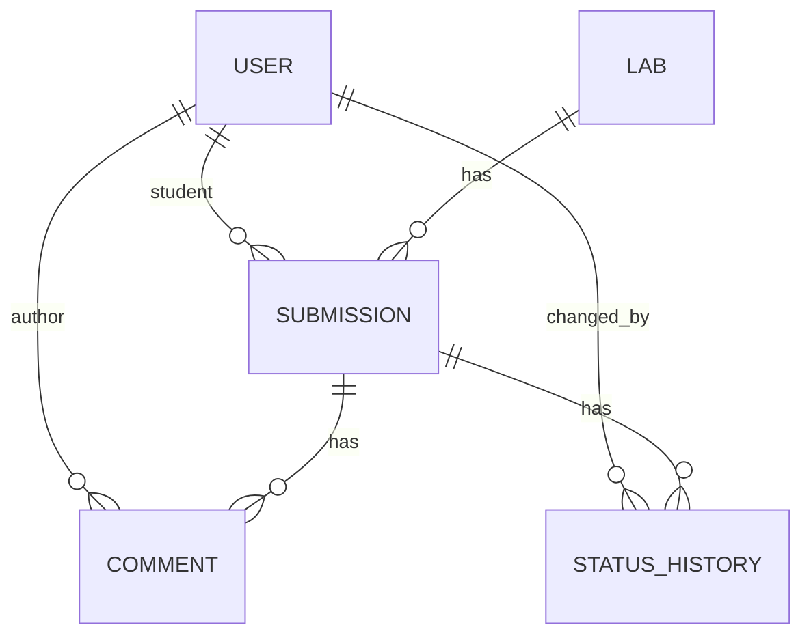
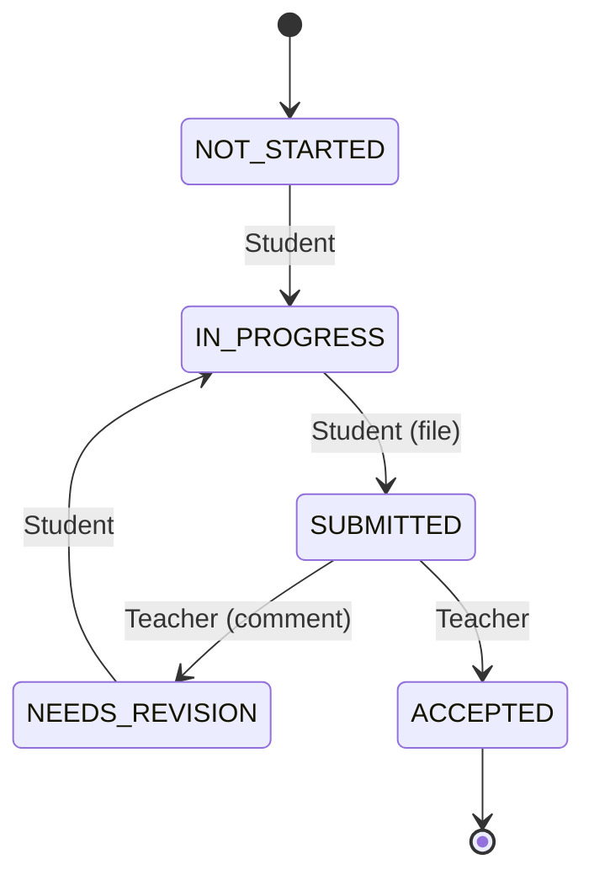

# Техническое задание и Декомпозиция проекта (WBS): LabFlow MVP

---

# ЧАСТЬ I. ИСХОДНОЕ ТЕХНИЧЕСКОЕ ЗАДАНИЕ (СПЕЦИФИКАЦИЯ ТРЕБОВАНИЙ)

## 1. Общие сведения
### 1.1. Наименование продукта
**LabFlow** — учебный веб-сервис учёта сдачи лабораторных работ.

### 1.2. Цель MVP
Автоматизация и прозрачность процесса сдачи/проверки лабораторных работ для 1 группы (20–30 студентов) и 1 преподавателя по 1 дисциплине.

### 1.3. Стейкхолдеры
| Роль | Интерес | Влияние |
| :--- | :--- | :--- |
| **Студент** | Видеть свои лабы, статусы, дедлайны, комментарии | Высокое |
| **Преподаватель** | Управлять лабами, проверять, комментировать | Высокое |
| **Староста** | Видеть сводку по группе (read-only) | Среднее |
| **Администратор** | Управлять пользователями, ролями | Низкое (в MVP — через Django Admin) |

### 1.4. Scope MVP (что входит)
1. Аутентификация и RBAC (3 роли).
2. CRUD лабораторных работ.
3. Загрузка отчётов студентами.
4. FSM статусов с аудитом.
5. Комментарии преподавателя.
6. Сводка по группе.
7. Telegram-уведомления (опционально).
8. Развёртывание через Docker Compose.

### 1.5. Out-of-scope (что НЕ входит)
* SPA, мобильное приложение.
* OAuth / SSO.
* Экспорт в Excel/CSV.
* Мультигрупповость, мультидисциплинарность.
* Плагины, публичный API для внешних систем.

### 1.6. Ограничения
* 1 группа, 1 дисциплина, 1 преподаватель.
* Одновременная нагрузка: до 30 пользователей.
* Файлы отчётов: `pdf`, `docx`, `zip`, не более 20 МБ.
* Хостинг: один сервер, Docker Compose.

### 1.7. Глоссарий
| Термин | Определение |
| :--- | :--- |
| **Lab** | Лабораторная работа (задание) |
| **Submission** | Сдача конкретного студента по конкретной лабе |
| **FSM** | Finite State Machine — конечный автомат статусов |
| **RBAC** | Role-Based Access Control — управление доступом на основе ролей |
| **is_overdue** | Вычисляемый флаг «просрочено», не хранится в БД |
| **StatusHistory** | Неизменяемый лог переходов статусов |

### 1.8. Архитектурный стек
* **Backend:** Python 3.11+, Django 5 + DRF, PostgreSQL 15+.
* **Frontend:** Django Templates + Bootstrap 5 (без SPA на MVP).
* **Инфраструктура:** Docker Compose, Nginx, Gunicorn.
* **Интеграции:** Telegram Bot API (уведомления).

---

## 2. Модель ресурсов (Data Domain)

### 2.1. ER-диаграмма


### 2.2. Лабораторная работа (Lab)
| Поле | Тип | Обяз. | Ограничения | Описание |
| :--- | :--- | :--- | :--- | :--- |
| `id` | UUID / int | да | PK | Идентификатор |
| `number` | int | да | > 0, unique | Порядковый номер |
| `title` | varchar(255) | да | 3–255 символов | Название |
| `description` | text | нет | до 10 000 символов | Задание |
| `deadline` | datetime | да | > now при создании | Дедлайн |
| `created_at` | datetime | да | auto | Дата создания |

*Индексы:* `unique(number)`, `index(deadline)`.

### 2.3. Сдача / Отчёт (Submission)
| Поле | Тип | Обяз. | Ограничения | Описание |
| :--- | :--- | :--- | :--- | :--- |
| `id` | UUID / int | да | PK | Идентификатор |
| `lab_id` | FK → Lab | да | ON DELETE CASCADE | Лабораторная работа |
| `student_id` | FK → User | да | ON DELETE CASCADE | Студент |
| `file_path` | varchar | нет | pdf/docx/zip, ≤ 20 МБ | Путь к файлу отчёта |
| `current_status` | enum Status | да | default `NOT_STARTED` | Текущий статус |
| `submitted_at` | datetime | нет | — | Последняя загрузка |
| `created_at` | datetime | да | auto | Создание записи |

*Ограничения:* `unique(lab_id, student_id)`, `index(current_status)`.

### 2.4. Комментарий (Comment)
| Поле | Тип | Обяз. | Ограничения | Описание |
| :--- | :--- | :--- | :--- | :--- |
| `id` | UUID / int | да | PK | Идентификатор |
| `submission_id` | FK → Submission | да | ON DELETE CASCADE | Сдача |
| `author_id` | FK → User | да | role=Teacher | Автор |
| `text` | text | да | 1–5000 символов | Текст комментария |
| `created_at` | datetime | да | auto | Время создания |

### 2.5. Запись истории статусов (StatusHistory)
| Поле | Тип | Обяз. | Ограничения | Описание |
| :--- | :--- | :--- | :--- | :--- |
| `id` | UUID / int | да | PK | Идентификатор |
| `submission_id` | FK → Submission | да | ON DELETE CASCADE | Сдача |
| `from_status` | enum Status | да | — | Исходный статус |
| `to_status` | enum Status | да | — | Новый статус |
| `changed_by` | FK → User | да | — | Пользователь, сменивший статус |
| `changed_at` | datetime | да | auto | Дата и время перехода |

*Правила:* Только `INSERT`. `UPDATE` и `DELETE` запрещены на уровне БД и приложения.

### 2.6. Enum Status
```text
NOT_STARTED | IN_PROGRESS | SUBMITTED | NEEDS_REVISION | ACCEPTED
```

---

## 3. Статусная модель (FSM)

### 3.1. Перечень статусов
| Код | Название | Цвет UI | Описание |
| :--- | :--- | :--- | :--- |
| `NOT_STARTED` | Не начата | Серый (`secondary`) | Студент ещё не приступал |
| `IN_PROGRESS` | В работе | Синий (`primary`) | Студент взял работу в работу |
| `SUBMITTED` | Сдана | Жёлтый (`warning`) | Файл загружен, ожидает проверки |
| `NEEDS_REVISION` | На доработке | Оранжевый (`danger`) | Преподаватель вернул с замечанием |
| `ACCEPTED` | Принята | Зелёный (`success`) | Финальный статус сдачи |

### 3.2. Правила переходов
#### Цепочка студента:
| # | From | To | Условие | Побочные эффекты | Ошибка при нарушении |
| :--- | :--- | :--- | :--- | :--- | :--- |
| **S1** | `NOT_STARTED` | `IN_PROGRESS` | Владелец сдачи | — | 403 `FORBIDDEN` |
| **S2** | `IN_PROGRESS` | `SUBMITTED` | Файл прикреплён | `submitted_at=now`, уведомление преподу | 400 `FILE_REQUIRED` |
| **S3** | `NEEDS_REVISION` | `IN_PROGRESS` | Владелец сдачи | — | 403 `FORBIDDEN` |
| **S4** | `*` | `ACCEPTED` | — | — | 403 `FORBIDDEN_ROLE` |
| **S5** | `SUBMITTED` | `*` | — | — | 403 `STUDENT_CANNOT_CHANGE_AFTER_SUBMIT` |

#### Цепочка преподавателя (только из `SUBMITTED`):
| # | From | To | Условие | Побочные эффекты | Ошибка |
| :--- | :--- | :--- | :--- | :--- | :--- |
| **T1** | `SUBMITTED` | `NEEDS_REVISION` | Комментарий обязателен | Уведомление студенту | 400 `COMMENT_REQUIRED` |
| **T2** | `SUBMITTED` | `ACCEPTED` | — | Уведомление студенту | — |
| **T3** | Любой другой | — | — | — | 400 `INVALID_TRANSITION` |

### 3.3. State-диаграмма


### 3.4. Вычисляемый флаг `is_overdue`
* Формула: `now > lab.deadline AND status != ACCEPTED`.
* Считается на лету через `annotate` в QuerySet. В БД не хранится.

---

## 4. Ролевая модель и разграничение доступа (RBAC)

| Операция / Ресурс | Студент | Преподаватель | Староста |
| :--- | :---: | :---: | :---: |
| `GET /labs` | ✅ (свои статусы) | ✅ | ✅ |
| `POST/PUT/PATCH/DELETE /labs` | ❌ | ✅ | ❌ |
| `POST /submissions` (upload) | ✅ (свой) | ❌ | ❌ |
| `GET /submissions/{id}` | ✅ (свой) | ✅ | ✅ |
| `PATCH /submissions/{id}/status` | ✅ (по цепочке S1–S3) | ✅ (T1–T2) | ❌ |
| `POST /submissions/{id}/comments` | ❌ | ✅ | ❌ |
| `GET /submissions/{id}/comments` | ✅ (свой) | ✅ | ✅ |
| `GET /summary` | ❌ | ✅ | ✅ |

*Object-level:* при попытке студента запросить чужой `/submissions/{id}` возвращается **404 Not Found** (сокрытие приватности).

---

## 5. Спецификация API
* **Base URL:** `/api/v1/`
* **Формат:** JSON / multipart/form-data.

| Метод | URL | Доступ | Назначение |
| :--- | :--- | :--- | :--- |
| `POST` | `/auth/login` | Все | Аутентификация, выдача токена/сессии |
| `POST` | `/auth/logout` | Все | Завершение сессии |
| `GET` | `/auth/me` | Все | Данные профиля текущего пользователя |
| `GET` | `/labs` | Все | Список лабораторных работ |
| `POST` | `/labs` | Teacher | Создание новой работы |
| `GET` | `/labs/{id}` | Все | Детальная информация по работе |
| `PATCH`| `/labs/{id}` | Teacher | Редактирование работы |
| `DELETE`|`/labs/{id}` | Teacher | Удаление работы |
| `GET` | `/submissions/my` | Student | Список моих сдач |
| `GET` | `/labs/{lab_id}/submissions` | Teacher, Headman | Сдачи по конкретной работе |
| `POST` | `/submissions` | Student | Загрузка отчёта (multipart) |
| `GET` | `/submissions/{id}` | По правам | Детали сдачи |
| `PATCH`| `/submissions/{id}/status` | Student, Teacher | Переход статуса по FSM |
| `GET` | `/submissions/{id}/history`| По правам | История статусов сдачи |
| `POST` | `/submissions/{id}/comments`| Teacher | Добавить комментарий |
| `GET` | `/submissions/{id}/comments`| По правам | Список комментариев |
| `GET` | `/summary` | Teacher, Headman | Сводная таблица группы |

---

# ЧАСТЬ II. ДЕТАЛЬНАЯ ДЕКОМПОЗИЦИЯ ЗАДАЧ (WBS И ПЛАН СПРИНТОВ)

### Параметры проекта:
* **Общий срок:** 3 недели (15 рабочих дней, 3 спринта по 1 неделе).
* **Команда проекта:**
  * **[BE] Backend Developer:** Python, Django, DRF, PostgreSQL, FSM, Бизнес-логика.
  * **[FE] Frontend Developer:** HTML5, CSS3, Bootstrap 5, Django Templates, JS.
  * **[OPS] DevOps Engineer:** Docker, Nginx, CI/CD, логирование, резервное копирование.
  * **[QA] QA Engineer:** Тест-кейсы, функциональное, регрессионное и нагрузочное тестирование.

---

## СПРИНТ 1: Архитектурный каркас, Модели данных и Базовый UI
**Период:** Дни 1–5 | **Фокус:** Разворачивание окружения, проектирование схемы БД, сиды и базовые шаблоны.

### Эпик 1. Инфраструктура и окружение (Infra & Setup)

#### Задача INF-01: Инициализация репозитория и окружения разработки
* **Ответственный:** DevOps
* **Срок:** День 1 (4 часа)
* **Приоритет:** Blocker (Must)
* **Подробное описание:**
  1. Создать структуру репозитория: `/backend`, `/frontend`, `/infra`, `/scripts`.
  2. Настроить файл `.gitignore` (Python, Django, IDE, Docker, static, media).
  3. Настроить `.editorconfig` (кодировка UTF-8, LF, отступы 4 пробела).
  4. Подключить линтеры и форматтеры: `ruff` / `flake8`, `black`, `isort`.
  5. Сконфигурировать `pre-commit` хуки для проверки линтеров перед коммитом.
* **Критерии приемки (DoD):**
  - [x] Репозиторий склонирован, линтеры отрабатывают без ошибок.
  - [x] Команда `pre-commit run --all-files` завершается со статусом 0.

#### Задача INF-02: Подготовка базового Docker Compose
* **Ответственный:** DevOps
* **Срок:** Дни 1–2 (6 часов)
* **Приоритет:** Blocker (Must)
* **Подробное описание:**
  1. Написать `Dockerfile` для backend-сервиса (Python 3.11-slim, multi-stage сборка).
  2. Создать `docker-compose.yml` со следующими сервисами:
     - `db`: образ `postgres:15-alpine`, health-check, volume `pgdata`.
     - `backend`: монтирование кода, запуск через `runserver` (dev) или `gunicorn` (prod).
  3. Создать `.env.example` с полным набором конфигурационных переменных.
* **Критерии приемки (DoD):**
  - [x] Команда `docker compose up -d` поднимает БД и Django без ошибок.
  - [x] База данных проходит health-check. Данные сохраняются при перезапуске контейнера.

#### Задача INF-03: Конфигурация Nginx и раздача медиа/статики
* **Ответственный:** DevOps
* **Срок:** День 2 (4 часа)
* **Приоритет:** High (Must)
* **Подробное описание:**
  1. Добавить сервис `nginx` в `docker-compose.yml`.
  2. Написать конфигурационный файл `nginx.conf`:
     - Проксирование `/` и `/api/` на gunicorn upstream.
     - Раздача статики `/static/` напрямую из тома `static_volume`.
     - Раздача отчётов `/media/` с защитой и заголовками кеширования.
     - Настройка директивы `client_max_body_size 20M`.
* **Критерии приемки (DoD):**
  - [x] Файлы больше 20 МБ отклоняются Nginx с кодом 413.
  - [x] Статические файлы отдаются со статус-кодом 200 без проксирования в Django.

---

### Эпик 2. База данных и модели (Data Domain)

#### Задача BE-01: Кастомная модель пользователя и роли (User & Roles)
* **Ответственный:** Backend Dev
* **Срок:** День 2 (4 часа)
* **Приоритет:** Blocker (Must)
* **Подробное описание:**
  1. Создать приложение `accounts`.
  2. Реализовать класс `User(AbstractUser)`:
     - `email`: уникальный логин (EmailField, unique=True).
     - `full_name`: varchar(255).
     - `role`: TextChoices (`STUDENT`, `TEACHER`, `HEADMAN`).
  3. Настроить `AUTH_USER_MODEL = 'accounts.User'` до первой миграции.
  4. Зарегистрировать модель в Django Admin с кастомными фильтрами по ролям.
* **Критерии приемки (DoD):**
  - [x] Миграции успешно применены в Postgres.
  - [x] Создание пользователей всех 3 ролей через Django shell и админку работает штатно.

#### Задача BE-02: Модели `Lab` и `Submission`
* **Ответственный:** Backend Dev
* **Срок:** День 3 (6 часов)
* **Приоритет:** Blocker (Must)
* **Подробное описание:**
  1. Создать приложение `core`.
  2. Описать модель `Lab`:
     - `number`: PositiveIntegerField(unique=True).
     - `title`: CharField(max_length=255).
     - `description`: TextField(blank=True).
     - `deadline`: DateTimeField(db_index=True). Валидатор: при создании дедлайн должен быть в будущем.
  3. Описать модель `Submission`:
     - `lab`: ForeignKey(Lab, on_delete=CASCADE).
     - `student`: ForeignKey(User, on_delete=CASCADE).
     - `file_path`: FileField(upload_to='submissions/%Y/%m/', validators=[...]).
     - `current_status`: CharField(choices=Status.choices, default=Status.NOT_STARTED, db_index=True).
     - `submitted_at`: DateTimeField(null=True, blank=True).
     - Meta: `unique_together = ('lab', 'student')`.
* **Критерии приемки (DoD):**
  - [x] Создание двух одинаковых сдач для одного студента и лабы блокируется на уровне БД (`UniqueConstraint`).
  - [x] Невозможно создать лабу с прошедшим дедлайном.

#### Задача BE-03: Модели `Comment` и `StatusHistory`
* **Ответственный:** Backend Dev
* **Срок:** Дни 3–4 (4 часа)
* **Приоритет:** High (Must)
* **Подробное описание:**
  1. Реализовать модель `Comment`:
     - `submission`: FK(Submission, on_delete=CASCADE).
     - `author`: FK(User, limit_choices_to={'role': 'TEACHER'}).
     - `text`: TextField (валидация 1–5000 символов).
     - `created_at`: DateTimeField(auto_now_add=True).
  2. Реализовать модель `StatusHistory`:
     - `submission`: FK(Submission, on_delete=CASCADE).
     - `from_status`: CharField.
     - `to_status`: CharField.
     - `changed_by`: FK(User, on_delete=SET_NULL, null=True).
     - `changed_at`: DateTimeField(auto_now_add=True).
  3. Переопределить метод `delete()` и `save()` у `StatusHistory`, чтобы запретить обновление и удаление существующих записей в ORM.
* **Критерии приемки (DoD):**
  - [x] Попытка вызвать `.update()` или `.delete()` на записи `StatusHistory` вызывает исключение.
  - [x] Создание комментария сохраняет связь с автором-преподавателем.

#### Задача BE-04: Сидер демонстрационных данных (`seed_demo`)
* **Ответственный:** Backend Dev
* **Срок:** День 4 (4 часа)
* **Приоритет:** Medium (Must)
* **Подробное описание:**
  1. Написать Django management-команду `seed_demo`.
  2. Генерировать:
     - 1 преподавателя (`teacher@labflow.ru` / `pass123`).
     - 1 старосту (`headman@labflow.ru` / `pass123`).
     - 25 студентов (`student1..25@labflow.ru` / `pass123`).
     - 5 лабораторных работ с разными дедлайнами (в прошлом и будущем).
     - Случайные сдачи в разных статусах с файлами-заглушками.
* **Критерии приемки (DoD):**
  - [x] Запуск `python manage.py seed_demo` заполняет чистую БД полным набором тестовых данных за < 5 секунд.

---

### Эпик 3. Каркас интерфейса (UI Framework)

#### Задача FE-01: Базовый шаблон и компоненты Bootstrap 5
* **Ответственный:** Frontend Dev
* **Срок:** День 4 (6 часов)
* **Приоритет:** High (Must)
* **Подробное описание:**
  1. Создать базовый шаблон `templates/base.html`.
  2. Подключить Bootstrap 5 (CSS, JS bundle), иконки Bootstrap Icons.
  3. Сверстать адаптивный навбар (логотип, навигационные ссылки по ролям, отображение роли и ФИО, кнопка выхода).
  4. Реализовать универсальный блок вывода flash-сообщений (`messages.success`, `messages.error`).
  5. Задать цветовую палитру бейджей статусов согласно ТЗ:
     - `NOT_STARTED` → серый (`bg-secondary`)
     - `IN_PROGRESS` → синий (`bg-primary`)
     - `SUBMITTED` → жёлтый (`bg-warning text-dark`)
     - `NEEDS_REVISION` → оранжевый (`bg-danger`)
     - `ACCEPTED` → зелёный (`bg-success`)
* **Критерии приемки (DoD):**
  - [x] Шаблон адаптивен для мобильных и десктопных экранов.
  - [x] Цвета статусов строго соответствуют дизайн-системе ТЗ.

#### Задача FE-02: Экран аутентификации (Login Page)
* **Ответственный:** Frontend Dev
* **Срок:** День 5 (4 часа)
* **Приоритет:** High (Must)
* **Подробное описание:**
  1. Сверстать форму входа: `templates/auth/login.html` (по центру экрана).
  2. Поля: email, пароль, кнопка «Войти».
  3. Реализовать клиентскую валидацию Bootstrap (подсветка пустых полей).
  4. Отображение ошибок неверных учетных данных и превышения лимита попыток.
* **Критерии приемки (DoD):**
  - [x] Валидный вход редиректит на главную страницу роли.
  - [x] Невалидные данные выводят аккуратный alert без перезагрузки стилей.

---

## СПРИНТ 2: Бизнес-логика, FSM, RBAC и Реализация сценариев
**Период:** Дни 6–10 | **Фокус:** Реализация FSM, загрузка файлов, разграничение доступа, рабочие места студента и преподавателя.

### Эпик 4. FSM и Сервисный слой (Core Logic)

#### Задача BE-05: Сервисный модуль конечного автомата (FSM Service)
* **Ответственный:** Backend Dev
* **Срок:** Дни 6–7 (8 часов)
* **Приоритет:** Blocker (Must)
* **Подробное описание:**
  1. Создать модуль `services/fsm.py`.
  2. Реализовать класс `SubmissionStateMachine`:
     - Описать граф переходов согласно правилам S1–S5 (студент) и T1–T3 (преподаватель).
     - Проверка прав инициатора смены статуса (студент может только свои переходы, преподаватель — только T1/T2).
     - Валидация: переход в `SUBMITTED` запрещен без прикрепленного файла.
     - Валидация: переход в `NEEDS_REVISION` запрещен без комментария.
  3. Гарантировать атомарность: обновление `Submission` и добавление записи в `StatusHistory` выполняются строго в `transaction.atomic()`.
* **Критерии приемки (DoD):**
  - [x] Попытка недопустимого перехода выбрасывает `InvalidTransitionError` (HTTP 400).
  - [x] Студент не может вызвать переход в `ACCEPTED` (HTTP 403).
  - [x] Каждая смена статуса создает запись в `StatusHistory`.

#### Задача BE-06: Расчет вычисляемого флага `is_overdue`
* **Ответственный:** Backend Dev
* **Срок:** День 7 (4 часа)
* **Приоритет:** High (Must)
* **Подробное описание:**
  1. В `models.py` создать кастомный `SubmissionQuerySet`:
     - Добавить метод `.with_overdue()`, вычисляющий поле `is_overdue` через SQL Expression (`Case`, `When`):
       `deadline < Now() AND current_status != 'ACCEPTED'`.
  2. Добавить свойство `is_overdue` в модель `Submission` для единичных объектов.
* **Критерии приемки (DoD):**
  - [x] Флаг возвращает `False`, если статус `ACCEPTED`, даже если дедлайн прошел год назад.
  - [x] Флаг возвращает `True`, если дедлайн просрочен, а статус `SUBMITTED`, `IN_PROGRESS` или `NEEDS_REVISION`.

#### Задача BE-07: Реализация ролевого доступа (RBAC & Object-Level Permissions)
* **Ответственный:** Backend Dev
* **Срок:** День 8 (6 часов)
* **Приоритет:** Blocker (Must)
* **Подробное описание:**
  1. Создать модуль `permissions.py`:
     - `IsTeacher`: доступ только для пользователей с ролью Teacher.
     - `IsStudent`: доступ для роли Student.
     - `IsHeadman`: доступ для роли Headman.
     - `IsSubmissionOwner`: проверка `obj.student == request.user`.
  2. В queryset для студентов автоматически фильтровать данные: `Submission.objects.filter(student=request.user)`.
  3. При запросе студентом чужой сдачи возвращать `404 Not Found` (не раскрывать существование).
* **Критерии приемки (DoD):**
  - [x] Студент не может получить доступ к данным другого студента ни при каких параметрах URL.

---

### Эпик 5. API и Загрузка отчётов

#### Задача BE-08: CRUD лабораторных работ (Labs Management)
* **Ответственный:** Backend Dev
* **Срок:** День 8 (4 часа)
* **Приоритет:** High (Must)
* **Подробное описание:**
  1. Реализовать View/API для создания, редактирования и просмотра лаб.
  2. Доступ к созданию и редактированию — только для преподавателя.
  3. Валидация: уникальность номера лабораторной, валидация дедлайна.
* **Критерии приемки (DoD):**
  - [x] Преподаватель успешно создаёт и редактирует лабу.
  - [x] Студент и староста видят лабу в режиме только для чтения.

#### Задача BE-09: Загрузка и валидация файлов отчётов (File Upload)
* **Ответственный:** Backend Dev
* **Срок:** День 9 (6 часов)
* **Приоритет:** Blocker (Must)
* **Подробное описание:**
  1. Реализовать эндпоинт загрузки отчёта студентом (`POST /submissions`).
  2. Валидация:
     - Форматы файлов строго: `.pdf`, `.docx`, `.zip` (проверка расширения и MIME-типа).
     - Размер файла: не более 20 МБ.
  3. Сохранение файла в структурированную директорию `/media/submissions/<lab_id>/<student_id>_<timestamp>.<ext>`.
  4. Автоматический вызов FSM: перевод из `IN_PROGRESS` в `SUBMITTED`, фиксация `submitted_at = now()`.
* **Критерии приемки (DoD):**
  - [x] Попытка загрузить файл `.exe` или файл размером 21 МБ отклоняется с ошибкой.
  - [x] После загрузки статус автоматически меняется на `SUBMITTED`.

#### Задача BE-10: Комментарии преподавателя и аудит
* **Ответственный:** Backend Dev
* **Срок:** День 9 (4 часа)
* **Приоритет:** High (Must)
* **Подробное описание:**
  1. Реализовать эндпоинт добавления комментария (`POST /submissions/{id}/comments`).
  2. Эндпоинт возврата работы на доработку: атомарно принимает комментарий и переводит статус в `NEEDS_REVISION`.
  3. Эндпоинт получения истории сдачи: список изменений статусов (из `StatusHistory`) и список комментариев.
* **Критерии приемки (DoD):**
  - [x] Попытка вернуть работу на доработку без комментария блокируется валидатором.

---

### Эпик 6. Реализация UI экранов

#### Задача FE-03: Кабинет студента («Мои лабы»)
* **Ответственный:** Frontend Dev
* **Срок:** Дни 7–8 (6 часов)
* **Приоритет:** High (Must)
* **Подробное описание:**
  1. Сверстать страницу со списком всех лабораторных работ.
  2. Отобразить карточки лаб: номер, тема, дедлайн, статус сдачи текущего студента (цветной бейдж).
  3. Если дедлайн просрочен (`is_overdue == true`), выводить предупреждающий бейдж «Просрочено».
  4. Реализовать состояния: «Загрузка» (спиннер), «Список пуст».
* **Критерии приемки (DoD):**
  - [x] Студент наглядно видит все свои дедлайны и актуальные статусы.

#### Задача FE-04: Экран сдачи лабораторной работы студентом
* **Ответственный:** Frontend Dev
* **Срок:** День 8 (6 часов)
* **Приоритет:** High (Must)
* **Подробное описание:**
  1. Сверстать страницу детального просмотра лабы: описание задания, скачивание методички (если есть).
  2. Форма загрузки файла (Drag-and-Drop или стандартный file input) с валидацией размера и формата на клиенте до отправки.
  3. Кнопка сдачи («Отправить на проверку»).
  4. Блок таймлайна: история изменения статусов с датами.
  5. Блок комментариев преподавателя с выделением замечаний.
* **Критерии приемки (DoD):**
  - [x] Файл отправляется на бэкенд, статус мгновенно обновляется без поломки интерфейса.

#### Задача FE-05: Кабинет преподавателя (Управление лабами и сдачи)
* **Ответственный:** Frontend Dev
* **Срок:** День 9 (8 часов)
* **Приоритет:** High (Must)
* **Подробное описание:**
  1. Страница списка лаб с кнопкой «Создать лабораторную работу» (модальное окно с полями: номер, тема, описание, дедлайн).
  2. Таблица сдачи по конкретной лабе: ФИО студента, текущий статус, дата сдачи, флаг просрочки, ссылка на скачивание отчёта.
  3. Фильтрация списка студентов по статусам (`Все`, `Ожидают проверки`, `На доработке`, `Приняты`).
* **Критерии приемки (DoD):**
  - [x] Преподаватель может отфильтровать только те работы, которые требуют проверки (`SUBMITTED`).

#### Задача FE-06: Панель проверки работы преподавателем
* **Ответственный:** Frontend Dev
* **Срок:** День 10 (6 часов)
* **Приоритет:** High (Must)
* **Подробное описание:**
  1. Страница проверки конкретной сдачи: скачивание файла студента.
  2. Кнопка «Принять работу» (перевод в `ACCEPTED`).
  3. Кнопка «Вернуть на доработку» (открывает модалку с обязательным полем ввода комментария).
  4. Блок добавления произвольного комментария к работе.
* **Критерии приемки (DoD):**
  - [x] Невозможно отправить форму доработки с пустым текстом замечания.

---

## СПРИНТ 3: Сводка, Уведомления, Тестирование и Релиз
**Период:** Дни 11–15 | **Фокус:** Сводная таблица группы, telegram-бот, E2E и нагрузочное тестирование, деплой.

### Эпик 7. Сводка группы и Уведомления

#### Задача BE-11: Агрегация статистики по группе (Summary Endpoint)
* **Ответственный:** Backend Dev
* **Срок:** День 11 (5 часов)
* **Приоритет:** High (Must)
* **Подробное описание:**
  1. Реализовать эндпоинт `GET /summary`.
  2. Собрать матрицу: строки — студенты группы, столбцы — номера лаб, ячейки — финальный статус.
  3. Добавить агрегированные счетчики: всего работ, сдано, принято, на доработке, просрочено.
  4. Ограничить доступ: только `Teacher` и `Headman`.
* **Критерии приемки (DoD):**
  - [x] Эндпоинт отдает корректную матрицу данных без N+1 запросов (использовать `select_related` / `prefetch_related`).

#### Задача FE-07: Экран сводной ведомости группы
* **Ответственный:** Frontend Dev
* **Срок:** Дни 11–12 (6 часов)
* **Приоритет:** High (Must)
* **Подробное описание:**
  1. Сверстать страницу сводки для преподавателя и старосты.
  2. Интерактивная таблица: подсветка статусов цветными индикаторами в ячейках.
  3. Верхний блок с карточками общей статистики (виджеты: «Всего сдано», «Просрочено»).
* **Критерии приемки (DoD):**
  - [x] Староста видит таблицу без кнопок редактирования и смены статусов (read-only).

#### Задача BE-12: Telegram-бот уведомлений (Опционально)
* **Ответственный:** Backend Dev
* **Срок:** День 12 (6 часов)
* **Приоритет:** Medium (Should)
* **Подробное описание:**
  1. Создать фоновый сервис отправки сообщений через Telegram Bot API.
  2. События:
     - Студент загрузил работу → уведомление преподавателю со ссылкой на проверку.
     - Преподаватель проверил работу (принял/вернул) → уведомление студенту со статусом и текстом комментария.
  3. Асинхронная отправка, не блокирующая основной HTTP-поток запроса.
* **Критерии приемки (DoD):**
  - [x] Уведомления корректно приходят в Telegram при наступлении событий.

---

### Эпик 8. Контроль качества (QA & Testing)

#### Задача QA-01: Автоматизированные Unit и Integration тесты
* **Ответственный:** QA Engineer / Backend
* **Срок:** Дни 12–13 (8 часов)
* **Приоритет:** High (Must)
* **Подробное описание:**
  1. Написать тесты на FSM переходы (все сценарии матрицы переходов).
  2. Тестирование формулы `is_overdue` (граничные временные интервалы).
  3. Тесты матриц доступа RBAC (попытка студента удалить лабу, изменить чужой статус).
  4. Добиться покрытия кодовой базы тестами ≥ 80%.
* **Критерии приемки (DoD):**
  - [x] Все тесты в pytest завершаются успешно, отчет coverage показывает ≥ 80%.

#### Задача QA-02: Ручное тестирование тест-кейсов (TC-01 – TC-20)
* **Ответственный:** QA Engineer
* **Срок:** День 14 (6 часов)
* **Приоритет:** High (Must)
* **Подробное описание:**
  1. Прогон тест-кейсов по матрице:
     - `TC-01`: Студент пытается выставить статус `ACCEPTED` вручную (ожидается 403).
     - `TC-02`: Преподаватель принимает `SUBMITTED` (ожидается 200 + запись в историю).
     - `TC-04`: Преподаватель возвращает на доработку без комментария (ожидается 400).
     - `TC-20`: Студент запрашивает сдачу другого студента по ID (ожидается 404).
  2. Кроссбраузерное тестирование UI (Chrome, Firefox, Safari).
* **Критерии приемки (DoD):**
  - [x] Баг-репорты заведены и устранены до статуса закрытия.

#### Задача QA-03: Нагрузочное тестирование (Performance Test)
* **Ответственный:** QA Engineer / DevOps
* **Срок:** День 14 (4 часа)
* **Приоритет:** Medium (Must)
* **Подробное описание:**
  1. Написать скрипт тестирования в k6 или Locust.
  2. Смоделировать одновременную работу 30 пользователей (загрузка файлов, просмотр списков, сдача лаб).
  3. Снять метрики времени отклика и утилизации ресурсов.
* **Критерии приемки (DoD):**
  - [x] 95-й перцентиль времени ответа (p95) < 300 мс при 30 параллельных пользователях. 0% упавших запросов.

---

### Эпик 9. Релиз, документация и финализация

#### Задача INF-04: Финализация сборки, Health-check и бэкапы
* **Ответственный:** DevOps
* **Срок:** День 15 (4 часа)
* **Приоритет:** High (Must)
* **Подробное описание:**
  1. Настроить health-check эндпоинт `/api/health/`.
  2. Написать скрипт ежедневного бэкапа PostgreSQL через `pg_dump` по расписанию cron.
  3. Проверить автоматический перезапуск контейнеров при падении (`restart: unless-stopped`).
* **Критерии приемки (DoD):**
  - [x] Дамп БД корректно создается и разворачивается в тестовом контуре.

#### Задача DOC-01: Документация проекта и Swagger
* **Ответственный:** Backend Dev
* **Срок:** День 15 (4 часа)
* **Приоритет:** High (Must)
* **Подробное описание:**
  1. Сгенерировать актуальную Swagger/OpenAPI спецификацию (`drf-spectacular`).
  2. Написать подробный `README.md`:
     - Требования к системе.
     - Инструкция по установке и запуску через Docker Compose за 3 команды.
     - Инструкция по запуску тестов и наполнению демо-данными (`seed_demo`).
* **Критерии приемки (DoD):**
  - [x] Новый разработчик может развернуть работающий проект с нуля по инструкции из README за 10 минут.

---

## 3. Сводная матрица ресурсов и трудозатрат

| Роль | Спринт 1 | Спринт 2 | Спринт 3 | Итого часов | Эквивалент (дни) |
| :--- | :---: | :---: | :---: | :---: | :---: |
| **Backend Developer** | 18h | 28h | 15h | **61h** | ~7.5 рабочих дней |
| **Frontend Developer** | 10h | 26h | 6h | **42h** | ~5.2 рабочих дней |
| **DevOps Engineer** | 14h | — | 6h | **20h** | ~2.5 рабочих дней |
| **QA Engineer** | — | — | 18h | **18h** | ~2.2 рабочих дней |
| **ИТОГО** | **42h** | **54h** | **45h** | **141h** | **17.5 человеко-дней** |

> **Резюме:** При одновременной командной работе план укладывается ровно в **3 календарные недели** (15 рабочих дней), обеспечивая полное соответствие критериям готовности (DoD) и функционалу MVP.
